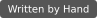

# Written by Hand


*A tiny badge for code made the old-fashioned way.*

It doesn't detect AI. It doesn't prove anything. It's just a little stamp of pride.

> **Self-declared, not verified.** A badge means whatever its maintainer says it means. Nothing is checked, nothing detects AI, and unmarked code is just *unmarked*.

## Get a badge now

Open the **[badge gallery](https://isaaskin.github.io/written-by-hand/)**, pick a style and a label, copy the Markdown, and paste it into your README. There's nothing to install and no account.

| Style | Badge | Compact |
|---|---|---|
| `stamp` |  |  |
| `classic` |  |  |
| `terminal` |  |  |
| `pixel` |  |  |
| `minimal` |  |  |
| `coffee` |  |  |

The gallery also offers *Handcrafted Code*, *Made by a Human, Allegedly* and *Artisanal bugs since 2026*. Gallery badges never show a percentage: nothing was scanned.

## Want it to show *which* code you wrote?

The `wbh` command-line tool lets you mark the files and blocks you wrote yourself. It then generates your badge and a report of exactly what you declared, linked from the badge. It's a single offline binary: no accounts, no network, no server.

### Quickstart

```sh
wbh init                     # writes .wbh.toml, .wbh/ outputs and a README badge
wbh mark src/dsp/Osc.cpp     # declare whole files (edits .wbh.toml only)
wbh scan                     # regenerate after adding @handwritten comments
```

Commit `.wbh.toml`, `.wbh/` and your README. The badge links to `.wbh/REPORT.md`, which lists every declared file and line range.

Change the look with `wbh badge set pixel --compact`. CLI badges can also show the marked percentage (`--percentage`), which is off by default because it moves with every code change:

  

For your own label, set `text = "Made with fingers & questionable decisions"` under `[badge]` in `.wbh.toml`.

## Marking code

Declare a whole file with a comment at the top:

```cpp
// @handwritten
#include <cmath>
```

Or declare a block:

```python
# @handwritten:start
def handcrafted():
    return "hello"
# @handwritten:end
```

You can also declare a whole file without touching it, using `wbh mark <file>`. `wbh` never edits your source files. See [docs/MARKERS.md](docs/MARKERS.md) for every comment form, the counting rules and known limitations.

## Commands

| Command | What it does |
|---|---|
| `wbh init [--style S] [--no-readme]` | Create `.wbh.toml`, generate outputs, insert the README badge. Never overwrites an existing config. |
| `wbh mark <file>...` / `wbh unmark <file>...` | Add or remove whole-file claims in `.wbh.toml`. |
| `wbh scan` | Rescan and regenerate. Only files whose content changed are written. |
| `wbh badge` | Show the current badge settings. |
| `wbh badge list` | List the styles. |
| `wbh badge set [STYLE] [--compact\|--no-compact] [--percentage\|--no-percentage]` | Change the badge and regenerate. |
| `wbh check [--strict]` | Validate markers and config without writing anything. `--strict` also fails when generated files are out of date. For CI; see [docs/CI.md](docs/CI.md). |

All commands accept `--root <path>`. Exit codes: `0` success; `1` invalid config or markers, stale or missing outputs, or another error; `2` invalid usage.

## Install

Download a prebuilt binary from [Releases](../../releases). No Rust, Node or Python needed.

| Platform | Archive |
|---|---|
| macOS, Apple Silicon | `wbh-aarch64-apple-darwin.tar.gz` |
| macOS, Intel | `wbh-x86_64-apple-darwin.tar.gz` |
| Linux x86_64 | `wbh-x86_64-unknown-linux-musl.tar.gz` |
| Linux ARM64 | `wbh-aarch64-unknown-linux-musl.tar.gz` |
| Windows x86_64 | `wbh-x86_64-pc-windows-msvc.zip` |

**macOS and Linux:** pick your archive from the table, then:

```sh
curl -fsSLO https://github.com/isaaskin/written-by-hand/releases/latest/download/wbh-aarch64-apple-darwin.tar.gz
curl -fsSLO https://github.com/isaaskin/written-by-hand/releases/latest/download/wbh-aarch64-apple-darwin.tar.gz.sha256
shasum -a 256 -c wbh-aarch64-apple-darwin.tar.gz.sha256
tar xzf wbh-aarch64-apple-darwin.tar.gz
sudo mv wbh-aarch64-apple-darwin/wbh /usr/local/bin/
```

If macOS refuses to open a binary downloaded with a browser, run `xattr -d com.apple.quarantine /usr/local/bin/wbh`.

**Windows (PowerShell):**

```powershell
Invoke-WebRequest https://github.com/isaaskin/written-by-hand/releases/latest/download/wbh-x86_64-pc-windows-msvc.zip -OutFile wbh.zip
Expand-Archive wbh.zip -DestinationPath $env:LOCALAPPDATA\wbh
# Then add $env:LOCALAPPDATA\wbh\wbh-x86_64-pc-windows-msvc to your PATH.
```

Every release includes a `.sha256` file per archive and a combined `SHA256SUMS`.

**With Cargo:** `cargo binstall written-by-hand` downloads the release binary, and `cargo install written-by-hand` builds it from source (Rust 1.88 or newer).

## Examples

[examples/](examples/) contains three small demo projects (C++, Rust and Python) with their generated badges and reports checked in.

## More

- [docs/MARKERS.md](docs/MARKERS.md): marker syntax and counting rules
- [docs/CI.md](docs/CI.md): running `wbh check` in GitHub Actions
- [docs/DECISIONS.md](docs/DECISIONS.md): design decisions and deviations from the spec
- [docs/LAUNCH.md](docs/LAUNCH.md): launch checklist and post drafts
- [CONTRIBUTING.md](CONTRIBUTING.md) and [CHANGELOG.md](CHANGELOG.md)

## License

MIT
